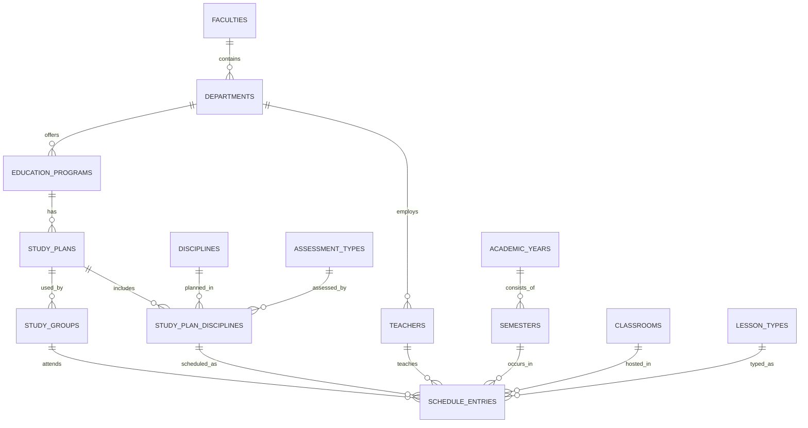

# ER-модель лабораторной работы № 1

Вариант № 6: система составления учебного графика дисциплин факультета. Диаграмма ниже соответствует актуальной схеме PostgreSQL: занятие ссылается на дисциплину через `study_plan_disciplines`.

