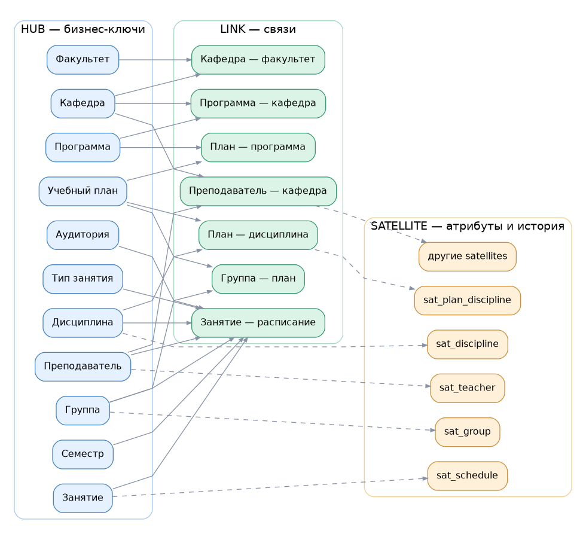

# Data Vault: вариант № 6

## Hub (бизнес-ключи)
`hub_faculty`, `hub_department`, `hub_program`, `hub_teacher`, `hub_discipline`, `hub_study_plan`, `hub_study_group`, `hub_semester`, `hub_classroom`, `hub_lesson_type`, `hub_schedule`.

## Link (связи)
`lnk_department_faculty`, `lnk_program_department`, `lnk_teacher_department`, `lnk_plan_program`, `lnk_group_plan`, `lnk_plan_discipline`, `lnk_schedule_assignment`.

## Satellite (описание и история)
По одному satellite на каждый Hub плюс `sat_plan_discipline`. Атрибуты меняются добавлением новой строки с `load_dts`, а не перезаписью исторической записи. Текущее расписание раскрывает view `dv.v_schedule_current`.

